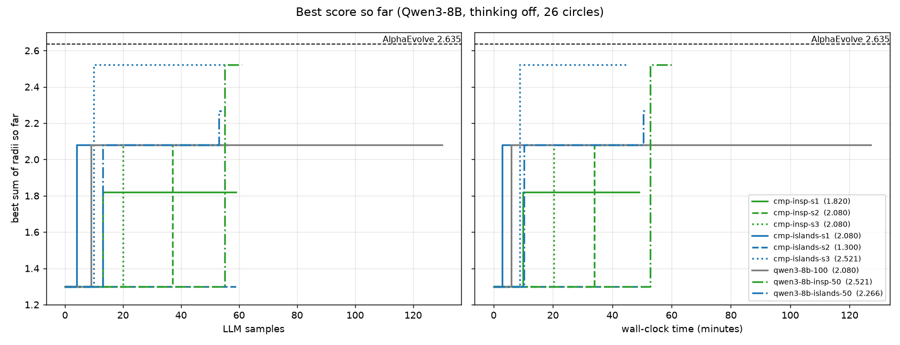
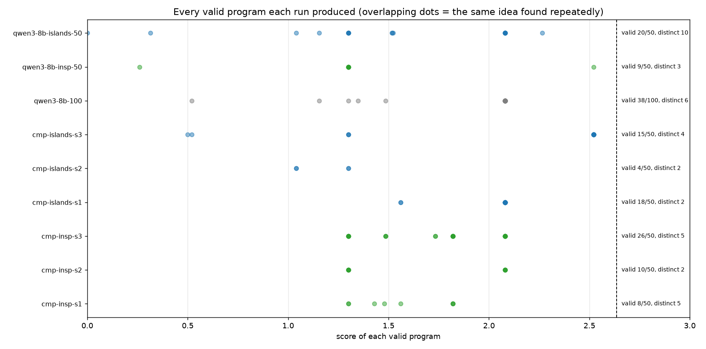

# AlphaEvolve from scratch: circle packing with a local LLM

A small reimplementation of the [AlphaEvolve](https://deepmind.google/discover/blog/alphaevolve-a-gemini-powered-coding-agent-for-designing-advanced-algorithms/)
loop. An LLM repeatedly edits a Python program, an evaluator scores every edit, and a database of
programs decides what to edit next. It runs entirely on a laptop: Qwen3-8B served by Ollama
on an Apple M2 with 16 GB of RAM.

**The problem:** place 26 non-overlapping circles inside the unit square so that the sum of their
radii is as large as possible. AlphaEvolve reported about **2.635**. The best found here is
**2.521** (96% of that), from a 1.30 starting program.

The LLM never writes down coordinates. It writes a program, `construct_packing()`, which may run
its own optimizer, so evolution improves a *search procedure* rather than a single answer.

---

## How it works

```
                 ┌───────────────── program database (islands) ─────────────────┐
                 │  island 0     island 1     island 2     island 3            │
                 │   ● ● ●        ● ●          ● ● ●        ● ●    ── migration every N iterations
                 └──────┬───────────────────────────────────────────────────────┘
          parent + inspirations
                        ▼
   prompt (problem, other programs with scores, current program, evaluator feedback, last failure)
                        ▼
              LLM (Qwen3-8B / Claude)  ──►  SEARCH/REPLACE edits  (full rewrite if they don't apply)
                        ▼
      evaluator: sandboxed subprocess, strict geometry checks  ──►  score + feedback  ──► database
```


### Files

| File | Purpose |
|---|---|
| `seed.py` | Starting program. Only the code between `# EVOLVE-BLOCK-START` and `# EVOLVE-BLOCK-END` may be edited; the harness below it, which writes the result, stays fixed. |
| `evaluate.py` | Runs a candidate in a temp directory under `sandbox-exec` (no network) with a timeout, then checks shapes, NaN/inf, negative radii, containment and pairwise overlap with tolerance `1e-9`. Returns the sum of radii, or 0 with an explanation. |
| `diff.py` | Parses and applies `<<<<<<< SEARCH / ======= / >>>>>>> REPLACE` edits, or a full rewrite of the evolve block. |
| `llm.py` | Two policies: any OpenAI-compatible server (Ollama, vLLM) and the Anthropic API. |
| `database.py` | Program store, islands, parent and inspiration sampling, migration. |
| `run.py` | The evolution loop. |
| `plot.py` | Step 7 plots from the run logs. |
| `overnight.sh` | The 6-run comparison of Step 4 and Step 5 described below. |
| `Modelfile.qwen3-16k` | Ollama model `qwen3:8b` with a 16k context window. |

---

## Setup

```bash
python3 -m venv .venv
.venv/bin/pip install -r requirements.txt     # numpy, scipy, openai, anthropic, matplotlib

# Local model via Ollama (https://ollama.com); keep the Ollama app running
ollama pull qwen3:8b
ollama create qwen3-16k -f Modelfile.qwen3-16k

.venv/bin/python evaluate.py seed.py          # sanity check: prints 1.30
```

The evaluator uses macOS `sandbox-exec`. On Linux, `run_program` in `evaluate.py` needs a different sandbox.

## Running

```bash
# Step 5 (default): islands + 3 inspirations
.venv/bin/python -u run.py --backend openai --base-url http://localhost:11434/v1 \
    --model qwen3-16k --no-think --iterations 50 --migration-interval 10 --rng-seed 1 \
    --out runs/my-run

# Step 4 only: turn inspirations off
... --inspirations 0

# Claude instead of a local model (needs ANTHROPIC_API_KEY; billed per token)
.venv/bin/python -u run.py --backend anthropic --model claude-opus-5-5 --iterations 50

# Plots for every run in runs/
.venv/bin/python plot.py
```

| Flag | Default | Meaning |
|---|---|---|
| `--islands` | 4 | number of islands |
| `--exploit` | 0.7 | probability of picking the island's best as the parent (otherwise a random member) |
| `--migration-interval` | 20 | iterations between migrations (0 = never) |
| `--inspirations` | 3 | other programs shown in the prompt (0 = off) |
| `--timeout` | 120 | seconds allowed per program evaluation |
| `--no-think` | off | turn off Qwen3 thinking. This makes it about 10× faster: around 1 minute per iteration instead of more than 10. |

Every run writes to `runs/<name>/`:
- `log.jsonl`: one record per iteration, with the prompt, completion, diff result, score, feedback, parent and inspiration ids, timings
- `programs.jsonl`: every distinct program, with its lineage
- `best.py`: the best program so far

For long runs, use `caffeinate -i` so the Mac doesn't sleep.

---

## Results

All runs use Qwen3-8B with thinking off, temperature 0.8, 50 iterations unless stated otherwise,
and about 1 minute per iteration. Almost all of that minute is spent generating text; evaluation takes 0.1–1.5 s.

### Best score so far



### Every valid program each run produced



### First runs (one run per step)

| Run | Setup | Best | Valid programs | Distinct valid scores | Time |
|---|---|---|---|---|---|
| `qwen3-8b-100` | Step 3, bare loop, 100 iterations | 2.080 | 38/100 | 6 | 127 min |
| `qwen3-8b-islands-50` | Step 4, islands | 2.266 | 20/50 | 10 | 52 min |
| `qwen3-8b-insp-50` | Step 5, inspirations (before the cold-start fix) | **2.521** | 9/50 | 3 | 60 min |

### Controlled comparison: Step 4 vs Step 5, 3 seeds each (`overnight.sh`)

Same settings (`--migration-interval 10`), with `--rng-seed` 1, 2 and 3. Step 5 includes the cold-start fix.

| | seed 1 | seed 2 | seed 3 | mean |
|---|---|---|---|---|
| **Step 4 best** (islands) | 2.080 | 1.300 | **2.521** | 1.967 |
| **Step 5 best** (+ inspirations) | 1.820 | 2.080 | 2.080 | 1.993 |
| Step 4 valid / distinct scores | 18 / 2 | 4 / 2 | 15 / 4 | 37/150 valid |
| Step 5 valid / distinct scores | 8 / 5 | 10 / 2 | 26 / 5 | 44/150 valid |

### What the programs found

| Score | Idea | How it was found |
|---|---|---|
| 1.30 | Seed: 6×6 grid, every radius 0.05 | the starting program |
| 2.08 | SLSQP grows the radii, but the centers stay on the 6×6 grid. The grid spacing is 0.16, so every r ≤ 0.08, and 26 × 0.08 = 2.08. | the most common local optimum in almost every run |
| 2.266 | Staggered, hex-like rows of 5, radii optimized | seed → island 3 (2.08) → migrated to island 0 → new layout. This is islands and migration working as intended. |
| **2.521** | SLSQP over **centers and radii together** | written in one attempt, twice in separate runs |

### Takeaways

1. **The score depends far more on luck than on the method.** The best scores range from 1.30 to 2.521 under the same settings. With 3 seeds per setup, Step 4 and Step 5 are statistically indistinguishable (means 1.97 and 1.99).
2. **Progress comes in jumps.** Every curve is flat with one or two jumps. AlphaEvolve's gradual climb, where each program builds on the last, almost never happens with an 8B model.
3. **Inspirations add a little variety.** Step 5 runs had more distinct valid scores in two of the three seeds and slightly more valid programs. This matches the purpose of inspirations, but it is a weak signal.
4. **The model is the bottleneck.** Only about 25% of the programs run correctly, and the same bugs keep coming back:
   - passing a function where SLSQP expects a constraint dict (`'function' object is not iterable`)
   - `numpy boolean subtract`
   - forgetting `from scipy.optimize import minimize`

   The search machinery can only select among ideas the model actually produces.
5. **The evaluator has to be strict.** One unconstrained program produced a radius of 18,915,562. Strict checks, NaN rejection and scoring in a separate process are what keep the scores honest.

---

## Limitations and next steps

- **Small samples.** 50 iterations and 3 seeds per setup is too little to separate methods with this much variance.
- **Step 6 isn't implemented.** On a single M2 GPU, generation dominates the time (about 70 s per iteration against at most 1.5 s of evaluation). An evaluation cascade would save under 2%, and parallel requests have to share the same GPU. This pays off on a GPU server or an API.
- **Possible next steps:**
  - restart evolution from the 2.521 program to test whether the loop can close the gap to 2.635
  - add the common SLSQP pitfalls to the prompt to raise the valid rate
  - a model ensemble: mostly fast samples with thinking off, plus a few with thinking on or from a larger model
  - more seeds per setup
  - the logged (prompt, completion, score) records can serve as RL training data for ThetaEvolve-style follow-ups
